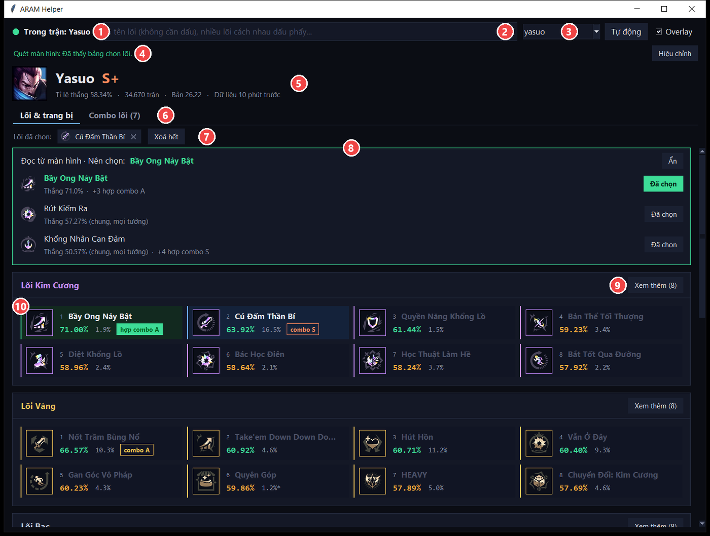
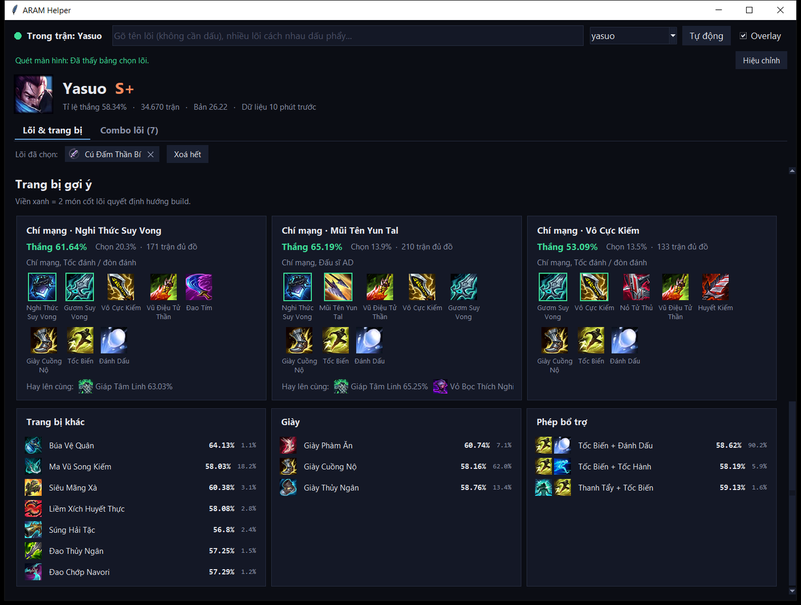
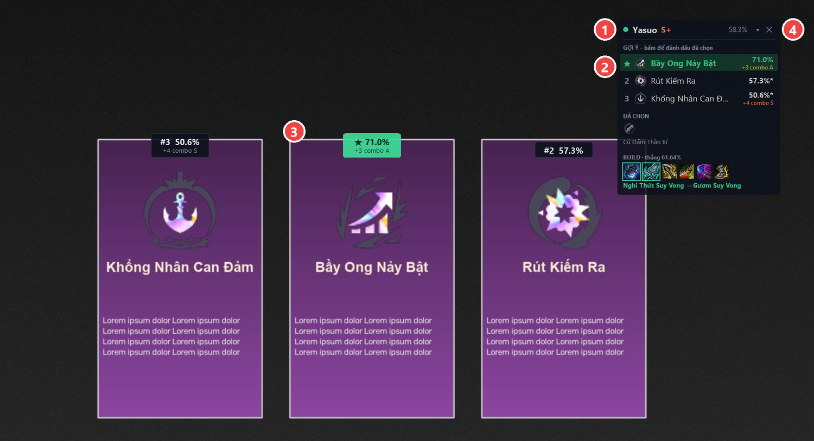

# Hướng dẫn sử dụng ARAM Helper

ARAM Helper gợi ý **lõi (augment)** và **trang bị** cho tướng bạn đang chơi trong chế độ **ARAM Hỗn Loạn**
của Liên Minh Huyền Thoại. Nguồn dữ liệu: [playaram.gg](https://playaram.gg).

| Tính năng | Windows | macOS |
|---|:-:|:-:|
| Tự nhận tướng khi vào trận | ✅ | ✅ |
| Bảng lõi Kim Cương / Vàng / Bạc, combo lõi, trang bị gợi ý | ✅ | ✅ |
| Tìm lõi, đánh dấu lõi đã chọn, gợi ý lõi hợp combo | ✅ | ✅ |
| Tự đọc 3 lõi đang được đưa ra trên màn hình | ✅ | – |
| Overlay trên game, phím tắt khi đang chơi | ✅ | – |

---

## 1. Cài đặt

### Windows 10 / 11
1. Tải mã nguồn: trên GitHub bấm **Code → Download ZIP**, giải nén vào một thư mục (vd. `D:\aram-helper`).
2. Bấm đúp **`install-windows.bat`**.
   - Chưa có Python 3.10+ thì script hỏi cài bằng `winget`; hoặc tự cài từ
     [python.org](https://www.python.org/downloads/) (nhớ tick *Add python.exe to PATH*) rồi chạy lại.
   - Script tạo môi trường riêng `.venv`, cài thư viện (1–2 phút), tạo shortcut **ARAM Helper**
     trên Desktop và Start Menu.
3. Mở **ARAM Helper** từ Desktop / Start Menu (hoặc bấm đúp `run.bat`).

Gỡ cài đặt: `powershell -ExecutionPolicy Bypass -File uninstall-windows.ps1`.

### macOS 11+
1. Tải và giải nén mã nguồn như trên.
2. Mở **Terminal** tại thư mục đó và chạy: `bash install-macos.sh`
   - Cần Python 3.10+ có tkinter: bản từ [python.org](https://www.python.org/downloads/macos/) có sẵn,
     Homebrew thì `brew install python@3.12 python-tk@3.12`.
   - Script tạo `.venv`, cài thư viện, tạo **ARAM Helper.app** trong `~/Applications` và `run-macos.command`.
3. Mở **ARAM Helper** từ Launchpad / Spotlight. Lần đầu macOS có thể chặn app tự tạo:
   chuột phải vào app → **Open** → **Open**.

Gỡ cài đặt: `bash uninstall-macos.sh`.

---

## 2. Dùng hằng ngày

| # | Phần | Dùng để |
|:-:|---|---|
| 1 | Trạng thái | Chấm **xanh** = đang trong trận, app tự nhận tướng |
| 2 | Ô tìm lõi | Gõ tên lõi không dấu, nhiều lõi cách nhau dấu phẩy |
| 3 | Chọn tướng + **Tự động** | Xem tướng khác; **Tự động** quay lại tướng trong trận |
| 4 | Trạng thái quét màn hình + **Hiệu chỉnh** | (Windows) app có đang đọc được bảng chọn lõi không |
| 5 | Tướng | Hạng tướng, tỉ lệ thắng, số trận, phiên bản |
| 6 | Tab | **Lõi & trang bị** / **Combo lõi** |
| 7 | Lõi đã chọn | Lõi bạn đã lấy trong trận này, bấm ✕ để bỏ |
| 8 | **Nên chọn** | 3 lõi đang được đưa ra, xếp hạng; bấm **Đã chọn** ở lõi bạn lấy |
| 9 | **Xem thêm** | Mở đủ 16 lõi của bậc đó |
| 10 | Thẻ lõi | Bấm để đánh dấu đã chọn; viền xanh = đang được gợi ý, nền xanh dương = đã chọn |

1. Mở ARAM Helper **trước hoặc trong lúc** vào trận ARAM Hỗn Loạn.
2. Khi vào trận, chấm tròn góc trên chuyển **xanh** và app tự hiện dữ liệu tướng bạn đang chơi.
   Muốn xem tướng khác (vd. lúc chọn tướng): gõ tên vào ô chọn tướng góc phải trên; bấm **Tự động** để quay lại.
3. Tab **Lõi & trang bị**:
   - 3 khối **Lõi Kim Cương / Vàng / Bạc**, mỗi khối 8 lõi mạnh nhất, **Xem thêm** để mở đủ 16.
   - Màu tỉ lệ thắng (so với tỉ lệ thắng chung của tướng): **xanh** cao hơn, **cam** ngang, **đỏ** thấp hơn.
     Dấu `*` sau tỉ lệ chọn = ít trận, số liệu dễ ảo.
   - Nhãn `combo S/A/B` = lõi nằm trong combo được gợi ý.
   - Phía dưới: **Trang bị gợi ý** – 3 bộ đồ 6 món (2 món viền xanh là cốt lõi), giày, phép bổ trợ.

   

4. Tab **Combo lõi**: các lối chơi, combo lõi và lý do, đồ khuyên dùng, mẹo. Combo có lõi bạn đã chọn
   được tô xanh kèm "đã có 1/3".

   

5. **Đánh dấu lõi đã chọn**: bấm vào thẻ lõi. Các lõi hợp combo với lõi đã có sẽ hiện nhãn xanh
   `hợp combo …` và được cộng điểm ở lượt chọn sau. Lõi đã chọn tự xoá khi vào trận mới.
6. **Tìm lõi bằng tay**: gõ tên lõi (không cần dấu, nhiều lõi cách nhau dấu phẩy), vd. `bay ong, vu luc, nhanh`
   → ô **Nên chọn** xếp hạng các lõi đó.

   

**Điểm gợi ý** = tỉ lệ thắng của lõi với tướng này + thưởng nếu hợp combo với lõi đã chọn
(S +4, A +3, B +2, C +1). Lõi không có trong top 16 của tướng dùng tỉ lệ thắng chung (ghi "chung").

---

## 3. Tự đọc lõi trên màn hình (Windows)

1. Trong cài đặt game, để chế độ hiển thị **Không viền (Borderless)** hoặc **Cửa sổ**
   (chế độ Toàn màn hình làm ảnh chụp bị đen, overlay cũng không nằm trên được).
2. **Hiệu chỉnh 1 lần** cho mỗi độ phân giải: khi bảng chọn 3 lõi **đang hiện** trong game, bấm
   **Ctrl+Alt+A** (hoặc nút **Hiệu chỉnh** trong app rồi quay lại game trong 5 giây). Mất khoảng 10 giây.
3. Từ đó mỗi lần bảng chọn lõi hiện ra, app tự đọc 3 lõi và hiện ô **Nên chọn** (trong app và trên overlay).
4. Sau khi chọn lõi trong game, đánh dấu cho app biết: bấm vào dòng gợi ý / nhãn trên overlay,
   hoặc **Ctrl+Alt+1 / 2 / 3** (ô thứ 1 / 2 / 3 từ trái sang).

Một số lõi dùng chung một icon; app đọc thêm tên lõi bằng OCR của Windows để phân biệt. Nếu vẫn chưa chắc,
ô gợi ý hiện "Một trong…" để bạn bấm đúng lõi.

---

## 4. Overlay trên game (Windows)

| # | Phần | Dùng để |
|:-:|---|---|
| 1 | Thanh tiêu đề | **Kéo** để di chuyển khung (app nhớ vị trí). Chấm xanh = đang thấy bảng chọn lõi, cam = chưa hiệu chỉnh |
| 2 | Gợi ý | 3 lõi xếp hạng, ★ = nên chọn. **Bấm vào dòng** = đánh dấu đã chọn lõi đó |
| 3 | Nhãn trên thẻ lõi | `★ 71.0%` lõi nên chọn, `#2`, `#3` lõi còn lại; bấm vào nhãn cũng đánh dấu đã chọn |
| 4 | **▾ / ▸** và **✕** | Thu gọn còn 1 dòng / ẩn overlay (hiện lại: Ctrl+Alt+O hoặc ô **Overlay** trong app) |

Bên dưới khung: lõi đã chọn và build đồ chính (2 món viền xanh là cốt lõi). Khi thu gọn, khung chỉ còn lõi nên chọn:

- Nền khung hơi trong suốt để vẫn nhìn được game phía sau.
- Bấm vào overlay **không làm game mất focus**.

### Phím tắt
| Phím | Việc |
|---|---|
| Ctrl+Alt+A | Hiệu chỉnh vị trí 3 ô lõi |
| Ctrl+Alt+1 / 2 / 3 | Đánh dấu đã chọn lõi ở ô 1 / 2 / 3 |
| Ctrl+Alt+O | Ẩn / hiện overlay |

Nếu tổ hợp phím đã bị app khác dùng, ARAM Helper tự đổi sang phím dự phòng
(Ctrl+Alt+K, Ctrl+Alt+Shift+A, Ctrl+Alt+Shift+1/2/3, Ctrl+Alt+Shift+O) và hiện phím đang dùng trong app / overlay.

---

## 5. Gặp sự cố

| Hiện tượng | Cách xử lý |
|---|---|
| Chấm không xanh khi đang trong trận | App chỉ nhận trận thật (không nhận màn chờ/chọn tướng). Đợi vào bản đồ vài giây. |
| "Không lấy được dữ liệu" | Kiểm tra mạng. App dùng dữ liệu cũ đã lưu nếu có. |
| "Ảnh chụp màn hình bị đen" | Đổi game sang Không viền / Cửa sổ. |
| Hiệu chỉnh báo không tìm thấy 3 lõi | Bấm lúc bảng chọn lõi đang hiện rõ, không bị che. Đổi độ phân giải thì hiệu chỉnh lại. |
| Đọc sai lõi | Hiệu chỉnh lại. Vẫn sai: chụp màn hình lúc chọn lõi, chạy `python screen_scan.py detect anh.png` và gửi kèm khi báo lỗi. |
| Overlay không hiện | Chỉ hiện khi đang trong trận; kiểm tra ô **Overlay** trong app; game phải ở chế độ Không viền. |
| Phím tắt không ăn | Xem phím đang dùng trong app / `data/app.log` (có thể đã đổi sang phím dự phòng). |
| Xem log lỗi | `data/app.log`, hoặc chạy `python app.py` trong Terminal để thấy log trực tiếp. |

---

## 6. Lưu ý

- ARAM Helper **chỉ đọc**: Live Client API chính thức của Riot (cổng 2999 trên máy) và ảnh chụp màn hình.
  App **không** đọc/ghi bộ nhớ game, **không** gửi phím/chuột vào game, **không** tự chọn lõi.
  Dù vậy, dùng công cụ bên thứ ba luôn do bạn tự cân nhắc theo chính sách hiện hành của Riot.
- Dữ liệu của app nằm trong thư mục `data/` (cache, icon, hiệu chỉnh, vị trí overlay, log) – xoá được bất cứ lúc nào.
