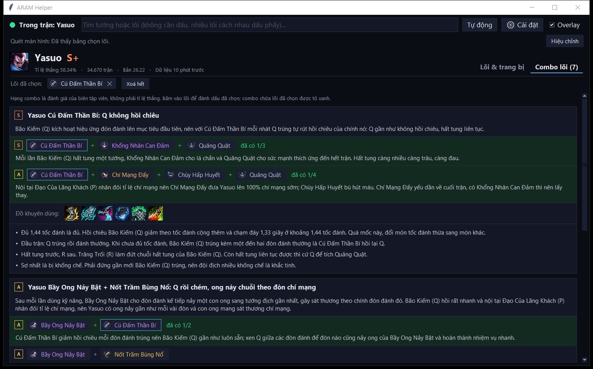
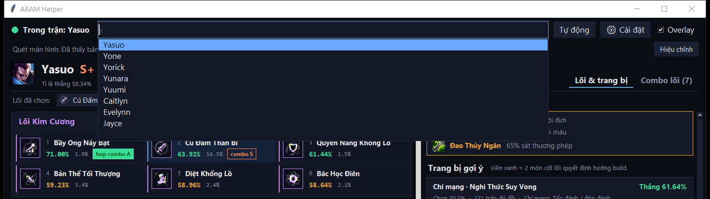
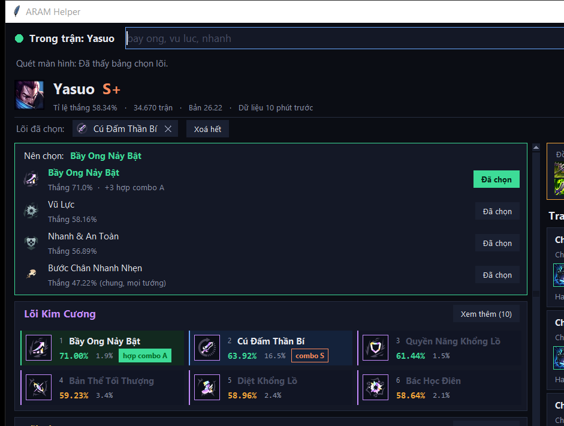
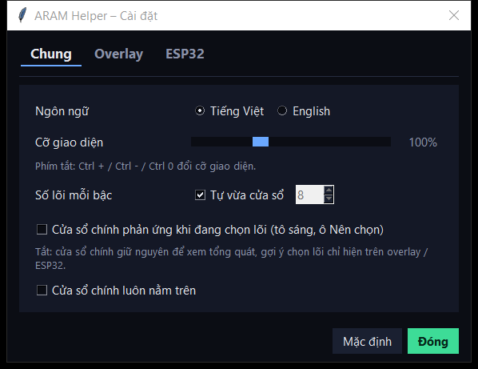
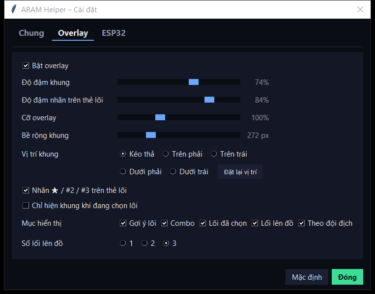
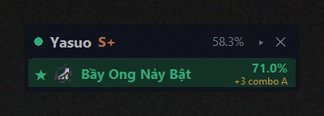

# Hướng dẫn sử dụng ARAM Helper

ARAM Helper gợi ý **lõi (augment)** và **trang bị** cho tướng bạn đang chơi trong chế độ **ARAM Hỗn Loạn**
của Liên Minh Huyền Thoại. Nguồn dữ liệu: [playaram.gg](https://playaram.gg).

| Tính năng | Windows | macOS |
|---|:-:|:-:|
| Tự nhận tướng khi vào trận | ✅ | ✅ |
| Bảng lõi Kim Cương / Vàng / Bạc, combo lõi, trang bị gợi ý | ✅ | ✅ |
| Tìm lõi, đánh dấu lõi đã chọn, gợi ý lõi hợp combo | ✅ | ✅ |
| Tự đọc 3 lõi đang được đưa ra trên màn hình | ✅ | – |
| Overlay trên game, phím tắt khi đang chơi | ✅ | – |

---

## 1. Cài đặt

### Windows 10 / 11
1. Tải mã nguồn: trên GitHub bấm **Code → Download ZIP**, giải nén vào một thư mục (vd. `D:\aram-helper`).
2. Bấm đúp **`install-windows.bat`**.
   - Chưa có Python 3.10+ thì script hỏi cài bằng `winget`; hoặc tự cài từ
     [python.org](https://www.python.org/downloads/) (nhớ tick *Add python.exe to PATH*) rồi chạy lại.
   - Script tạo môi trường riêng `.venv`, cài thư viện (1–2 phút), tạo shortcut **ARAM Helper**
     trên Desktop và Start Menu.
3. Mở **ARAM Helper** từ Desktop / Start Menu (hoặc bấm đúp `run.bat`).

Gỡ cài đặt: `powershell -ExecutionPolicy Bypass -File uninstall-windows.ps1`.

### macOS 11+
1. Tải và giải nén mã nguồn như trên.
2. Mở **Terminal** tại thư mục đó và chạy: `bash install-macos.sh`
   - Cần Python 3.10+ có tkinter: bản từ [python.org](https://www.python.org/downloads/macos/) có sẵn,
     Homebrew thì `brew install python@3.12 python-tk@3.12`.
   - Script tạo `.venv`, cài thư viện, tạo **ARAM Helper.app** trong `~/Applications` và `run-macos.command`.
3. Mở **ARAM Helper** từ Launchpad / Spotlight. Lần đầu macOS có thể chặn app tự tạo:
   chuột phải vào app → **Open** → **Open**.

Gỡ cài đặt: `bash uninstall-macos.sh`.

---

## 2. Dùng hằng ngày


| # | Phần | Dùng để |
|:-:|---|---|
| 1 | Trạng thái | Chấm **xanh** = đang trong trận, app tự nhận tướng |
| 2 | Ô tìm kiếm | Gõ tên **tướng** → danh sách chọn nhanh; gõ tên **lõi** (nhiều lõi cách nhau dấu phẩy) → tô sáng + xếp hạng |
| 3 | **Tự động** + **Cài đặt** | **Tự động** quay lại tướng trong trận; **Cài đặt** mở các tuỳ chọn (mục 2b) |
| 4 | Trạng thái quét màn hình + **Hiệu chỉnh** | (Windows) app có đang đọc được bảng chọn lõi không |
| 5 | Tướng | Hạng tướng, tỉ lệ thắng, số trận, phiên bản |
| 6 | Tab | **Lõi & trang bị** / **Combo lõi** |
| 7 | Lõi đã chọn | Lõi bạn đã lấy trong trận này, bấm ✕ để bỏ |
| 8 | **Xem thêm** | Mở đủ 16 lõi của bậc đó |
| 9 | Thẻ lõi | Bấm để đánh dấu đã chọn; viền xanh = đang được tìm, nền xanh dương = đã chọn |
| 10 | Trang bị | Đồ theo đội địch, 3 lối lên đồ, trang bị khác, giày, phép bổ trợ |

1. Mở ARAM Helper **trước hoặc trong lúc** vào trận ARAM Hỗn Loạn.
2. Khi vào trận, chấm tròn góc trên chuyển **xanh** và app tự hiện dữ liệu tướng bạn đang chơi.
3. Tab **Lõi & trang bị** – **lõi và trang bị nằm cạnh nhau**, xem cùng lúc không phải cuộn:
   - Bên trái: 3 khối **Lõi Kim Cương / Vàng / Bạc**. Số lõi mỗi bậc **tự vừa cửa sổ** (cửa sổ cao thì hiện
     nhiều hàng hơn, thấp thì ít hơn); **Xem thêm** để mở đủ 16. Muốn cố định số lõi: **Cài đặt → Số lõi mỗi bậc**.
   - Màu tỉ lệ thắng (so với tỉ lệ thắng chung của tướng): **xanh** cao hơn, **cam** ngang, **đỏ** thấp hơn.
     Dấu `*` sau tỉ lệ chọn = ít trận, số liệu dễ ảo.
   - Nhãn `combo S/A/B` = lõi nằm trong combo được gợi ý (thẻ hẹp hiện gọn `◆A`).
   - Bên phải: **đồ theo đội địch** (2 dòng, khi đang trong trận), **Trang bị gợi ý** – 3 lối lên đồ 6 món
     (2 món viền xanh là cốt lõi), rồi trang bị khác, giày, phép bổ trợ. Rê chuột lên icon để xem tên món.
   - Cửa sổ rất hẹp (dưới ~640 px) thì 2 phần xếp chồng lên nhau trong 1 cột cuộn.
   - **Ctrl +** / **Ctrl −** phóng to / thu nhỏ chữ, **Ctrl 0** về 100%. Bố cục tự xếp lại theo cỡ mới.
4. Tab **Combo lõi**: các lối chơi, combo lõi và lý do, đồ khuyên dùng, mẹo. Combo có lõi bạn đã chọn
   được tô xanh kèm "đã có 1/3".

   

5. **Xem tướng khác** (vd. lúc chọn tướng): gõ vài chữ tên tướng vào ô tìm kiếm (không cần dấu, gõ `ms`, `master`
   hay `yi` đều được) → danh sách hiện ngay bên dưới, chọn bằng chuột hoặc **↑ ↓ Enter**, **Esc** để huỷ.
   Bấm **Tự động** để quay lại tướng trong trận.

   

6. **Đánh dấu lõi đã chọn**: bấm vào thẻ lõi. Các lõi hợp combo với lõi đã có sẽ hiện nhãn xanh
   `hợp combo …` và được cộng điểm ở lượt chọn sau. Lõi đã chọn tự xoá khi vào trận mới.
7. **Tìm lõi bằng tay**: gõ tên lõi (không cần dấu, nhiều lõi cách nhau dấu phẩy), vd. `bay ong, vu luc, nhanh`
   → ô **Nên chọn** xếp hạng các lõi đó.

   

8. **Khi đang chọn lõi trong game**, cửa sổ chính **giữ nguyên** để bạn xem tổng quát; gợi ý chọn lõi hiện trên
   overlay (và ESP32). Muốn cửa sổ chính cũng tô sáng + hiện ô **Nên chọn**: bật trong **Cài đặt → Chung**.

**Điểm gợi ý** = tỉ lệ thắng của lõi với tướng này + thưởng nếu hợp combo với lõi đã chọn
(S +4, A +3, B +2, C +1). Lõi không có trong top 16 của tướng dùng tỉ lệ thắng chung (ghi "chung").

### 2b. Cài đặt

Bấm **⚙ Cài đặt** ở thanh trên. Mọi thay đổi áp dụng ngay và được nhớ cho lần sau (`data/settings.json`).
**Mặc định** đưa thẻ đang mở về giá trị ban đầu.



| Thẻ | Tuỳ chọn |
|---|---|
| **Chung** | **Ngôn ngữ** Tiếng Việt / English (giao diện, tên lõi, tên trang bị, tên tướng); **Cỡ giao diện** 70–160%; **Số lõi mỗi bậc** (tự vừa cửa sổ hoặc cố định 1–16); cửa sổ chính có phản ứng khi đang chọn lõi hay không; cửa sổ chính luôn nằm trên |
| **Overlay** (Windows) | Bật/tắt; **độ đậm** khung và nhãn trên thẻ lõi; **cỡ** overlay; **bề rộng** khung; **vị trí** (kéo thả hoặc 4 góc màn hình, **Đặt lại vị trí**); bật/tắt nhãn ★ trên thẻ lõi; chỉ hiện khung khi đang chọn lõi; chọn **mục hiển thị** (Gợi ý lõi, Combo, Lõi đã chọn, Lối lên đồ, Theo đội địch); số lối lên đồ 1–3 |
| **ESP32** | Bật/tắt gửi màn ARAM lên ESP32 (mục 4b) |



Ở tiếng Anh, mô tả lối chơi / lý do combo vẫn là tiếng Việt (nguồn dữ liệu chỉ có tiếng Việt).
OCR đọc tên lõi được cả khi game để tiếng Việt hay tiếng Anh.

---

## 3. Tự đọc lõi trên màn hình (Windows)

1. Trong cài đặt game, để chế độ hiển thị **Không viền (Borderless)** hoặc **Cửa sổ**
   (chế độ Toàn màn hình làm ảnh chụp bị đen, overlay cũng không nằm trên được).
2. **Hiệu chỉnh 1 lần** cho mỗi độ phân giải: khi bảng chọn 3 lõi **đang hiện** trong game, bấm
   **Ctrl+Alt+A** (hoặc nút **Hiệu chỉnh** trong app rồi quay lại game trong 5 giây). Mất khoảng 10 giây.
3. Từ đó mỗi lần bảng chọn lõi hiện ra, app tự đọc 3 lõi và hiện gợi ý trên overlay (cửa sổ chính chỉ hiện khi bật trong Cài đặt).
   Nếu vị trí thẻ lõi xê dịch so với lúc hiệu chỉnh, app tự dò lại và cập nhật vị trí.
4. Sau khi chọn lõi trong game, đánh dấu cho app biết: bấm vào dòng gợi ý / nhãn trên overlay,
   hoặc **Ctrl+Alt+1 / 2 / 3** (ô thứ 1 / 2 / 3 từ trái sang).

Một số lõi dùng chung một icon; app đọc thêm tên lõi bằng OCR của Windows để phân biệt. Nếu vẫn chưa chắc,
ô gợi ý hiện "Một trong…" để bạn bấm đúng lõi.

---

## 4. Overlay trên game (Windows)


| # | Phần | Dùng để |
|:-:|---|---|
| 1 | Thanh tiêu đề | **Kéo** để di chuyển khung (app nhớ vị trí). Chấm xanh = đang thấy bảng chọn lõi, cam = chưa hiệu chỉnh |
| 2 | Gợi ý | 3 lõi xếp hạng, ★ = nên chọn. **Bấm vào dòng** = đánh dấu đã chọn lõi đó |
| 3 | Nhãn trên thẻ lõi | `★ 71.0%` lõi nên chọn, `#2`, `#3` lõi còn lại; bấm vào nhãn cũng đánh dấu đã chọn |
| 4 | **▾ / ▸** và **✕** | Thu gọn còn 1 dòng / ẩn overlay (hiện lại: Ctrl+Alt+O hoặc ô **Overlay** trong app) |

Bên dưới phần gợi ý:

- **COMBO** (chỉ hiện khi đang chọn lõi): tối đa 3 cặp/bộ combo có chứa lõi đang được đưa ra, ưu tiên combo
  hoàn thành được với lõi bạn đã có. Icon viền **xanh lá** = lõi đang được đưa ra, viền **xanh lam** = lõi đã có,
  "có 1/3" = đã có bao nhiêu lõi của combo.
- **ĐÃ CHỌN**: các lõi bạn đã lấy trong trận.
- **LỐI LÊN ĐỒ**: tối đa 3 lối lên đồ kèm tỉ lệ thắng; 2 món viền xanh là món cốt lõi.
- **THEO ĐỘI ĐỊCH** (2 dòng cuối, chỉ khi đang trong trận): món nên lên dựa trên 5 tướng địch và trang bị họ đang có,
  kèm lý do ngắn. Ví dụ "Lời Nhắc Tử Vong – 3/5 địch hồi máu", "Đao Thủy Ngân – 65% sát thương phép".
  App xét: số tướng hồi máu mạnh (→ giảm hồi máu), tướng đỡ đòn / địch lên giáp hoặc kháng phép (→ xuyên giáp / xuyên phép),
  tỉ lệ sát thương phép – vật lý (→ món kháng phép / giáp), số tướng khống chế cứng (→ giày kháng hiệu ứng);
  món được chọn theo kiểu tướng của bạn và bỏ qua món bạn đã có. Đây là gợi ý theo kinh nghiệm, không phải thống kê.
  Cùng 2 dòng này cũng hiện trong cửa sổ chính, ngay trên **Trang bị gợi ý**.

Khi thu gọn, khung chỉ còn lõi nên chọn:



- Nền khung trong suốt khá nhiều để game vẫn nổi bật phía sau.
- Bấm vào overlay **không làm game mất focus**.

### Phím tắt
| Phím | Việc |
|---|---|
| Ctrl+Alt+A | Hiệu chỉnh vị trí 3 ô lõi |
| Ctrl+Alt+1 / 2 / 3 | Đánh dấu đã chọn lõi ở ô 1 / 2 / 3 |
| Ctrl+Alt+O | Ẩn / hiện overlay |
| Ctrl+Alt+D | Lưu ảnh chẩn đoán (khi app không đọc được lõi – xem mục 5) |

Nếu tổ hợp phím đã bị app khác dùng, ARAM Helper tự đổi sang phím dự phòng
(Ctrl+Alt+K, Ctrl+Alt+Shift+A, Ctrl+Alt+Shift+1/2/3, Ctrl+Alt+Shift+O, Ctrl+Alt+Shift+D) và hiện phím đang dùng
trong app / overlay.

---

## 4b. Màn ARAM trên ESP32 (PC Control Deck)

Nếu bạn có màn CYD chạy [PC Control Deck](https://github.com/doancongtrucit/esp-control) đã kết nối Wi-Fi,
ARAM Helper đẩy luôn tóm tắt trận lên đó qua Wi-Fi (cùng kênh UDP + token với thông báo PC):

- Vào trận → CYD **tự mở màn ARAM**: tướng + hạng + tỉ lệ thắng; **PICK** 3 lõi đang được đưa ra (chấm xanh = nên chọn,
  "+3 A" = điểm combo); hoặc **BUILD / TAKEN** giữa các lượt chọn; **COMBO** tốt nhất; **VS ENEMY TEAM** 2 dòng đồ theo đội địch.
- Hết trận (hoặc 15 giây không nhận gói) → tự quay lại màn trước đó. Bấm nút Home trên CYD → không tự mở lại cho tới ván sau.

Cài đặt (1 lần): cập nhật firmware + bridge PC Control Deck bản có màn ARAM, rồi tạo file `data/esp32.json`:

```json
{"bridge_dir": "<thư mục host của PC Control Deck>"}
```

ARAM Helper đọc token trong `config.json` của bridge và IP thiết bị trong `device_state.json` (bridge ghi khi CYD
báo đã có Wi-Fi). Hoặc khai báo thẳng `{"host": "<IP>", "port": 4210, "token": "<token>"}`. Không có file thì tính năng tắt.

---

## 5. Gặp sự cố

| Hiện tượng | Cách xử lý |
|---|---|
| Chấm không xanh khi đang trong trận | App chỉ nhận trận thật (không nhận màn chờ/chọn tướng). Đợi vào bản đồ vài giây. |
| "Không lấy được dữ liệu" | Kiểm tra mạng. App dùng dữ liệu cũ đã lưu nếu có. |
| "Ảnh chụp màn hình bị đen" | Đổi game sang Không viền / Cửa sổ. |
| Hiệu chỉnh báo không tìm thấy 3 lõi | Bấm lúc bảng chọn lõi đang hiện rõ, không bị che. Đổi độ phân giải thì hiệu chỉnh lại. App tự lưu ảnh lúc đó vào `data/debug/`. |
| Bảng chọn lõi hiện mà app không gợi ý | Xem dòng **Quét màn hình** trong app (có "khớp tốt nhất 0.xx"). App tự dò lại khi thẻ lõi xê dịch so với lúc hiệu chỉnh; vẫn không được thì hiệu chỉnh lại (Ctrl+Alt+A) khi bảng chọn đang hiện. |
| Đọc sai / không đọc được lõi | Khi bảng chọn lõi **đang hiện**, bấm **Ctrl+Alt+D** → app lưu ảnh + kết quả quét vào `data/debug/`. Gửi các file đó kèm `data/app.log` khi báo lỗi. |
| Overlay không hiện | Chỉ hiện khi đang trong trận; kiểm tra ô **Overlay** trong app; game phải ở chế độ Không viền. |
| Phím tắt không ăn | Xem phím đang dùng trong app / `data/app.log` (có thể đã đổi sang phím dự phòng). |
| Xem log lỗi | `data/app.log`, hoặc chạy `python app.py` trong Terminal để thấy log trực tiếp. |

---

## 6. Lưu ý

- ARAM Helper **chỉ đọc**: Live Client API chính thức của Riot (cổng 2999 trên máy) và ảnh chụp màn hình.
  App **không** đọc/ghi bộ nhớ game, **không** gửi phím/chuột vào game, **không** tự chọn lõi.
  Dù vậy, dùng công cụ bên thứ ba luôn do bạn tự cân nhắc theo chính sách hiện hành của Riot.
- Dữ liệu của app nằm trong thư mục `data/` (cache, icon, hiệu chỉnh, vị trí overlay, log) – xoá được bất cứ lúc nào.
