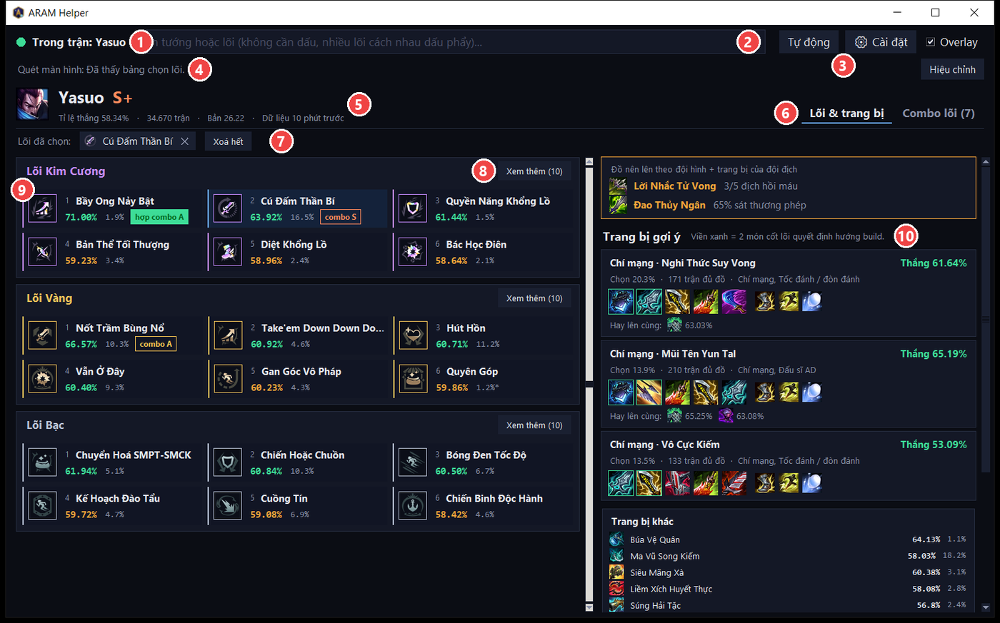
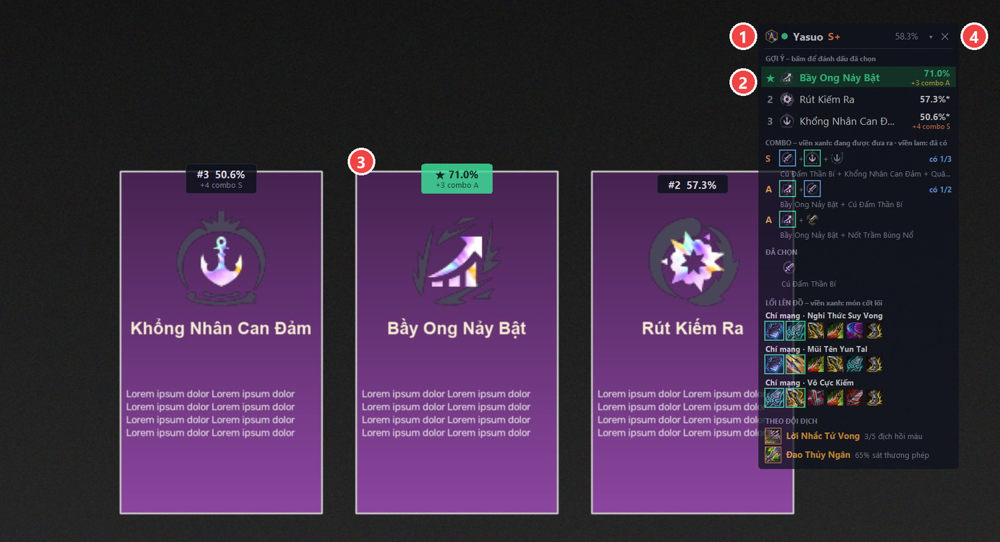

<h1 align="center">ARAM Helper</h1>

<b>Gợi ý lõi và trang bị cho ARAM Hỗn Loạn – ngay trên game.</b>

  <a href="https://github.com/doancongtrucit/aram-helper/releases/latest"><b>Tải về</b></a> ·
  <a href="docs/USER_GUIDE.md">Hướng dẫn</a> ·
  <a href="CHANGELOG.md">Có gì mới</a>

Ứng dụng máy tính gợi ý **lõi (augment)** và **trang bị** cho tướng bạn đang chơi trong **ARAM Hỗn Loạn**
(Liên Minh Huyền Thoại) – tự nhận tướng, tự đọc 3 lõi đang được đưa ra và gợi ý ngay trên game.

## Tính năng

- **Tự nhận tướng** khi vào trận qua Live Client Data API chính thức của Riot.
- **Lõi Kim Cương / Vàng / Bạc** (6 lõi mạnh nhất mỗi bậc, xem thêm tới 16) và **trang bị** trên cùng một màn,
  tự xếp bố cục theo cỡ cửa sổ và mức phóng to.
- **Combo lõi** kèm lý do, 3 lối lên đồ, giày, phép bổ trợ, **đồ nên lên theo đội hình + trang bị của đội địch**.
- **Tự đọc lõi trên màn hình** (Windows): nhận icon, đọc tên bằng OCR cho lõi dùng chung icon và lõi kỹ năng tướng.
- **Overlay** gọn, trong suốt trên game; bấm để đánh dấu lõi đã chọn mà không làm game mất focus.
- Tìm nhanh tướng / lõi, giao diện **Tiếng Việt / English**, nhiều tuỳ chọn hiển thị, tự báo khi có bản mới.
- Tuỳ chọn: hiển thị tóm tắt trận trên màn ESP32 (PC Control Deck).

## Tải về

Tải bản mới nhất tại **[Releases](https://github.com/doancongtrucit/aram-helper/releases/latest)** – không cần cài Python.

| Hệ điều hành | File |
|---|---|
| Windows 10 / 11 (64-bit) | `ARAM-Helper-<phiên bản>-Setup.exe` (khuyên dùng) hoặc `…-win64-portable.zip` |
| macOS 11+ | `ARAM-Helper-<phiên bản>-macos.zip` (cửa sổ chính; chưa có đọc màn hình / overlay) |

App chưa có chữ ký số: Windows hiện "Windows protected your PC" → **More info → Run anyway**;
macOS → chuột phải vào app → **Open**.

## Tài liệu

| | |
|---|---|
| 📖 [Hướng dẫn sử dụng](docs/USER_GUIDE.md) | Cài đặt, cách dùng, hiệu chỉnh đọc màn hình, overlay, phím tắt, xử lý sự cố |
| 📝 [Nhật ký thay đổi](CHANGELOG.md) | Thay đổi qua từng phiên bản |
| 🛠 [Phát triển](CONTRIBUTING.md) | Cấu trúc mã nguồn, chạy từ mã nguồn, test, build và phát hành |

## An toàn

ARAM Helper **chỉ đọc** (Live Client API trên máy + ảnh chụp màn hình): không đọc/ghi bộ nhớ game,
không gửi phím/chuột vào game, không tự chọn lõi. Dùng công cụ bên thứ ba do bạn tự cân nhắc theo chính sách
hiện hành của Riot.

Nguồn dữ liệu thống kê: [playaram.gg](https://playaram.gg). ARAM Helper không liên kết với Riot Games.
