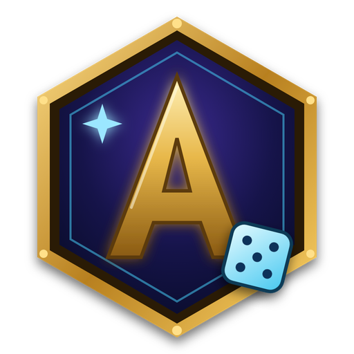
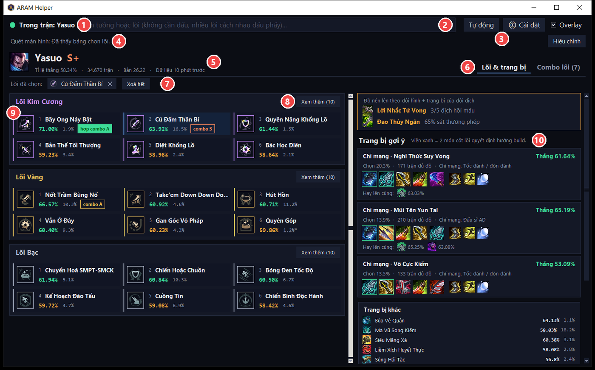
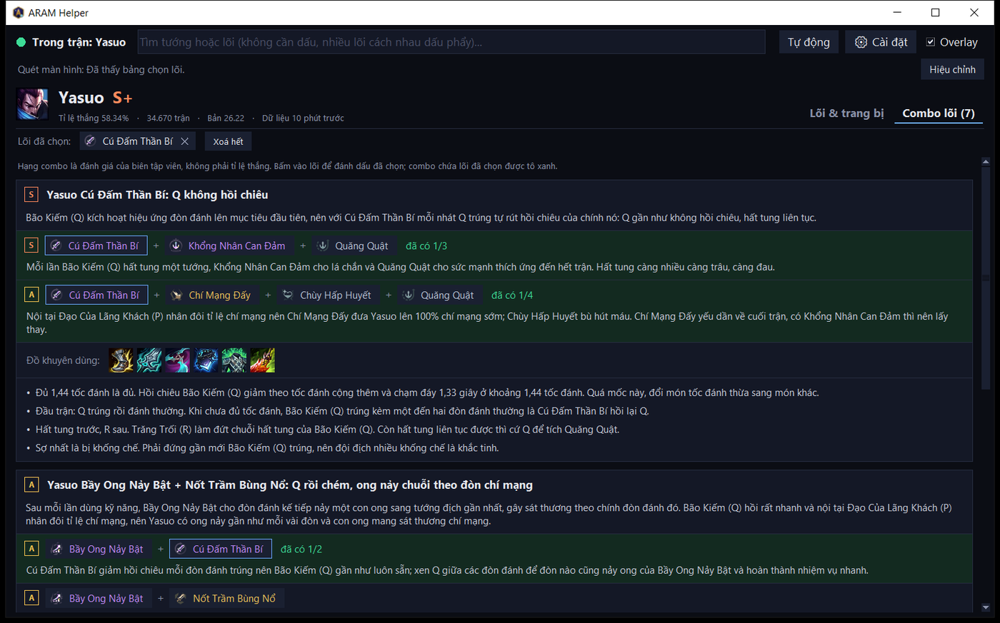
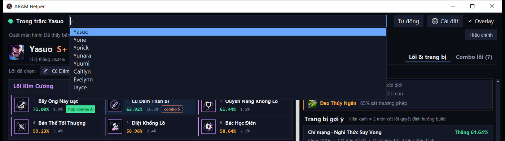
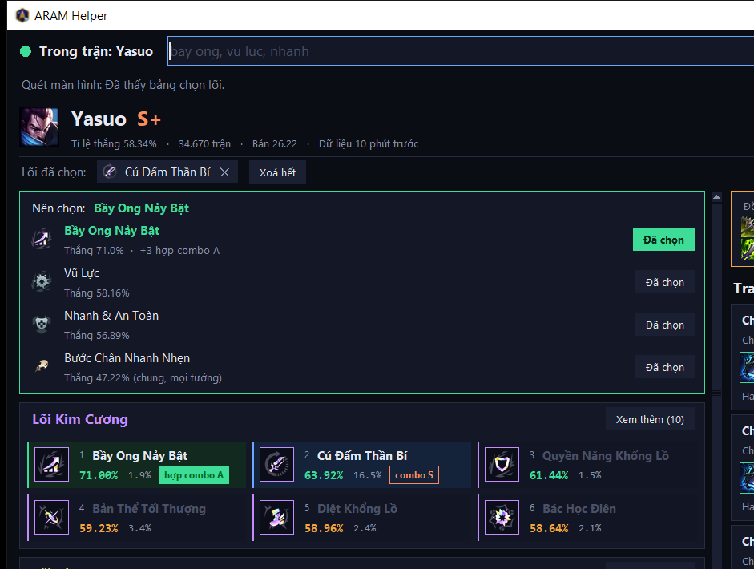
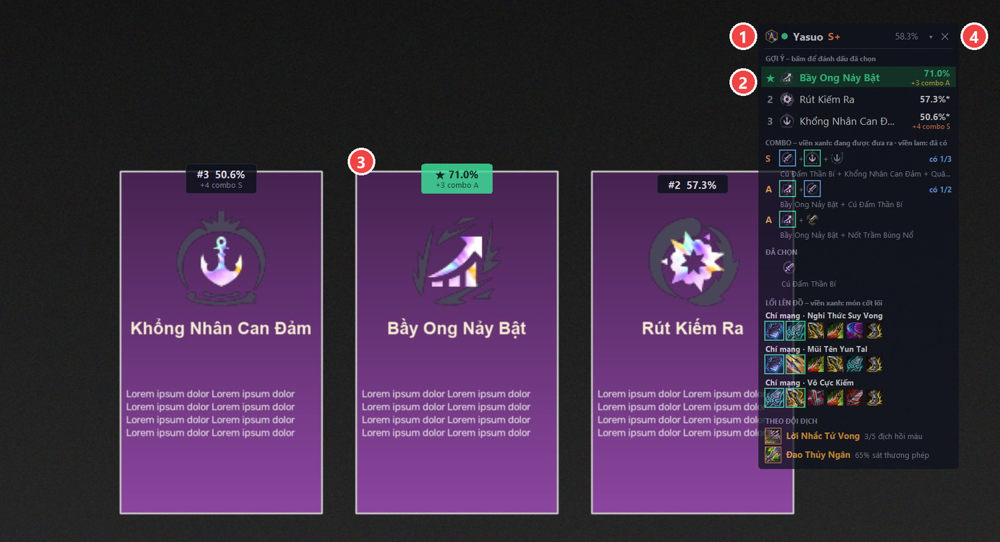
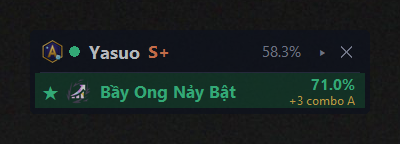
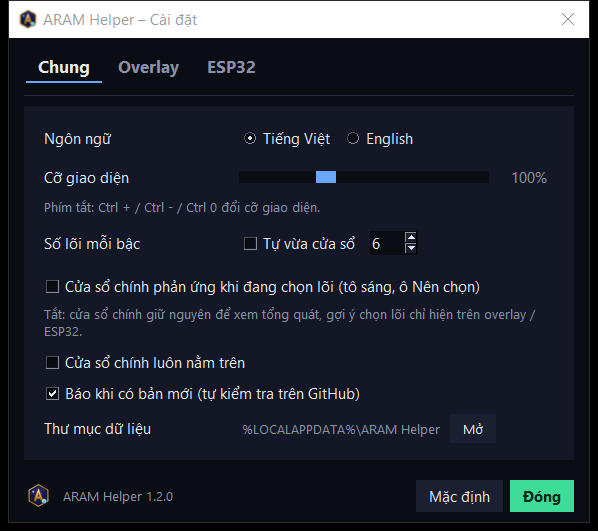
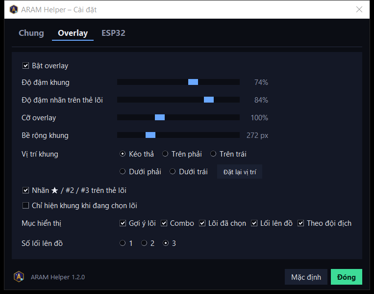

# ARAM Helper – Hướng dẫn sử dụng

ARAM Helper gợi ý **lõi (augment)** và **trang bị** cho tướng bạn đang chơi trong chế độ **ARAM Hỗn Loạn** của
Liên Minh Huyền Thoại. App tự nhận tướng khi vào trận, đọc 3 lõi đang được đưa ra trên màn hình, xếp hạng chúng
và hiện gợi ý ngay trên game.

Nguồn dữ liệu thống kê: [playaram.gg](https://playaram.gg) · Dữ liệu tướng / trang bị: Riot Data Dragon.

## Mục lục

1. [Yêu cầu hệ thống](#1-yêu-cầu-hệ-thống)
2. [Cài đặt, cập nhật, gỡ cài đặt](#2-cài-đặt-cập-nhật-gỡ-cài-đặt)
3. [Bắt đầu nhanh](#3-bắt-đầu-nhanh)
4. [Cửa sổ chính](#4-cửa-sổ-chính)
5. [Tự đọc lõi trên màn hình](#5-tự-đọc-lõi-trên-màn-hình)
6. [Overlay trên game](#6-overlay-trên-game)
7. [Cài đặt app](#7-cài-đặt-app)
8. [Phím tắt](#8-phím-tắt)
9. [Màn ARAM trên ESP32 (tuỳ chọn)](#9-màn-aram-trên-esp32-tuỳ-chọn)
10. [Xử lý sự cố](#10-xử-lý-sự-cố)
11. [Quyền riêng tư và an toàn](#11-quyền-riêng-tư-và-an-toàn)

---

## 1. Yêu cầu hệ thống

| Tính năng | Windows 10 / 11 (64-bit) | macOS 11+ |
|---|:-:|:-:|
| Tự nhận tướng khi vào trận | ✅ | ✅ |
| Lõi Kim Cương / Vàng / Bạc, combo lõi, trang bị gợi ý, đồ theo đội địch | ✅ | ✅ |
| Tìm tướng / lõi, đánh dấu lõi đã chọn, gợi ý lõi hợp combo | ✅ | ✅ |
| Tự đọc 3 lõi đang được đưa ra trên màn hình | ✅ | – |
| Overlay trên game, phím tắt khi đang chơi | ✅ | – |

- Game để chế độ hiển thị **Không viền (Borderless)** hoặc **Cửa sổ** – chế độ Toàn màn hình làm ảnh chụp màn hình
  bị đen và overlay không nằm trên game được.
- Cần Internet để tải dữ liệu lần đầu (sau đó app dùng dữ liệu đã lưu khi mất mạng).
- Dung lượng: ~150 MB sau khi cài, RAM khi chạy ~70–90 MB.

---

## 2. Cài đặt, cập nhật, gỡ cài đặt

### 2.1. Tải về

Vào trang **[Releases](https://github.com/doancongtrucit/aram-helper/releases/latest)** và chọn file phù hợp:

| File | Dành cho | Ghi chú |
|---|---|---|
| `ARAM-Helper-<phiên bản>-Setup.exe` | Windows – **khuyên dùng** | Bộ cài, không cần quyền admin, có shortcut Desktop / Start Menu |
| `ARAM-Helper-<phiên bản>-win64-portable.zip` | Windows – không cài | Giải nén là chạy; dữ liệu nằm ngay trong thư mục đó (chép sang USB / máy khác được) |
| `ARAM-Helper-<phiên bản>-macos.zip` | macOS | Giải nén, kéo `ARAM Helper.app` vào **Applications** |

### 2.2. Cài trên Windows

1. Bấm đúp `ARAM-Helper-<phiên bản>-Setup.exe`.
2. Nếu Windows hiện **"Windows protected your PC"** (app chưa có chữ ký số): bấm **More info → Run anyway**.
3. Chọn có tạo biểu tượng Desktop / mở cùng Windows hay không → **Install**.
4. Mở **ARAM Helper** từ Start Menu hoặc Desktop.

### 2.3. Cài trên macOS

1. Giải nén `…-macos.zip`, kéo **ARAM Helper.app** vào **Applications**.
2. Lần đầu mở: chuột phải vào app → **Open** → **Open**.
   Nếu macOS báo app "bị hỏng", mở Terminal và chạy: `xattr -cr "/Applications/ARAM Helper.app"`.

### 2.4. Cập nhật

Khi có bản mới, thanh trên của app hiện nút xanh **⬆ Có bản mới** – bấm để mở trang tải.
Windows: chạy `Setup.exe` của bản mới, cài đè lên bản cũ (app đang mở sẽ được đóng tự động).
Cài đặt, hiệu chỉnh và dữ liệu đã lưu được giữ nguyên.

### 2.5. Gỡ cài đặt

- Windows: **Settings → Apps → ARAM Helper → Uninstall**. Trình gỡ hỏi có xoá luôn dữ liệu của app không.
- macOS: xoá `ARAM Helper.app`; dữ liệu nằm ở `~/Library/Application Support/ARAM Helper`.

### 2.6. Thư mục dữ liệu

App lưu cache, icon, hiệu chỉnh, cài đặt và log trong:

| Bản | Thư mục |
|---|---|
| Windows – bản cài | `%LOCALAPPDATA%\ARAM Helper` |
| Windows – portable | thư mục `data\` cạnh `ARAM Helper.exe` |
| macOS | `~/Library/Application Support/ARAM Helper` |

Mở nhanh: **⚙ Cài đặt → Chung → Thư mục dữ liệu → Mở**. Xoá thư mục này bất cứ lúc nào để làm mới hoàn toàn.

---

## 3. Bắt đầu nhanh

1. Mở ARAM Helper **trước hoặc trong lúc** vào trận ARAM Hỗn Loạn.
2. Khi vào trận, chấm tròn góc trên chuyển **xanh** và app tự hiện dữ liệu tướng bạn đang chơi.
3. (Windows) Lần đầu, khi bảng chọn 3 lõi **đang hiện** trong game, bấm **Ctrl+Alt+A** để hiệu chỉnh
   (khoảng 10 giây). Từ đó mỗi lần chọn lõi, overlay tự gợi ý lõi nên chọn.
4. Sau khi chọn lõi trong game, bấm vào dòng gợi ý trên overlay (hoặc **Ctrl+Alt+1 / 2 / 3**) để app biết bạn
   đã lấy lõi nào – các lượt sau sẽ ưu tiên lõi hợp combo.

---

## 4. Cửa sổ chính



| # | Phần | Công dụng |
|:-:|---|---|
| 1 | Trạng thái | Chấm **xanh** = đang trong trận, app tự nhận tướng |
| 2 | Ô tìm kiếm | Gõ tên **tướng** → danh sách chọn nhanh; gõ tên **lõi** (nhiều lõi cách nhau dấu phẩy) → tô sáng và xếp hạng |
| 3 | **Tự động** · **⚙ Cài đặt** | **Tự động** quay lại tướng trong trận; **Cài đặt** mở các tuỳ chọn (mục 7) |
| 4 | Quét màn hình · **Hiệu chỉnh** | (Windows) trạng thái đọc bảng chọn lõi |
| 5 | Tướng | Hạng tướng, tỉ lệ thắng, số trận, phiên bản dữ liệu |
| 6 | Tab | **Lõi & trang bị** · **Combo lõi** |
| 7 | Lõi đã chọn | Lõi bạn đã lấy trong trận; bấm ✕ để bỏ |
| 8 | **Xem thêm** | Mở đủ 16 lõi của bậc đó (mặc định hiện 6 lõi mạnh nhất) |
| 9 | Thẻ lõi | Bấm để đánh dấu đã chọn; nền xanh dương = đã chọn |
| 10 | Trang bị | Đồ theo đội địch, 3 lối lên đồ, trang bị khác, giày, phép bổ trợ |

### 4.1. Lõi và trang bị

- **Lõi** (bên trái) chia 3 bậc **Kim Cương / Vàng / Bạc**, mỗi bậc hiện **6 lõi mạnh nhất**; bấm **Xem thêm**
  để xem đủ 16. Có thể đổi số lõi hoặc chọn "Tự vừa cửa sổ" trong **Cài đặt → Chung**.
- Màu tỉ lệ thắng so với tỉ lệ thắng chung của tướng: **xanh** cao hơn, **cam** ngang, **đỏ** thấp hơn.
  Dấu `*` sau tỉ lệ chọn = ít trận, số liệu chưa ổn định.
- Nhãn `combo S/A/B` = lõi nằm trong combo được đề xuất; `hợp combo …` = hợp với lõi bạn đã chọn.
- **Trang bị** (bên phải): 2 dòng **đồ theo đội địch** (khi đang trong trận), **3 lối lên đồ** 6 món
  (2 món viền xanh là cốt lõi), rồi trang bị khác, giày, phép bổ trợ. Rê chuột lên icon để xem tên món.
- Cửa sổ rất hẹp (dưới ~640 px) thì 2 phần xếp chồng thành 1 cột.
- **Ctrl +** / **Ctrl −** phóng to / thu nhỏ, **Ctrl 0** về 100%.

### 4.2. Tab Combo lõi

Các lối chơi của tướng, combo lõi kèm lý do, đồ khuyên dùng và mẹo. Combo có lõi bạn đã chọn được tô xanh
kèm "đã có 1/3". Hạng combo là đánh giá của biên tập viên nguồn dữ liệu, không phải tỉ lệ thắng.



### 4.3. Xem tướng khác

Gõ vài chữ tên tướng vào ô tìm kiếm (không cần dấu: `ms`, `master` hay `yi` đều được) → chọn trong danh sách
bằng chuột hoặc **↑ ↓ Enter**, **Esc** để huỷ. Bấm **Tự động** để quay lại tướng trong trận.



### 4.4. Tìm lõi bằng tay

Gõ tên lõi (không cần dấu, nhiều lõi cách nhau dấu phẩy), ví dụ `bay ong, vu luc, nhanh` → ô **Nên chọn**
xếp hạng các lõi đó, lõi ngoài top 6 cũng được hiện ra.



### 4.5. Cách xếp hạng lõi

**Điểm gợi ý** = tỉ lệ thắng của lõi với tướng này + thưởng nếu hợp combo với lõi đã chọn
(S +4, A +3, B +2, C +1). Lõi ngoài top 16 của tướng dùng tỉ lệ thắng chung của mọi tướng (ghi "chung").

Khi đang chọn lõi trong game, cửa sổ chính **giữ nguyên** để bạn xem tổng quát – gợi ý hiện trên overlay
(và ESP32). Muốn cửa sổ chính cũng tô sáng + hiện ô **Nên chọn**, bật trong **Cài đặt → Chung**.

---

## 5. Tự đọc lõi trên màn hình

*(Windows)*

1. **Hiệu chỉnh 1 lần** cho mỗi độ phân giải: khi bảng chọn 3 lõi **đang hiện** trong game, bấm **Ctrl+Alt+A**
   (hoặc nút **Hiệu chỉnh** trong app rồi quay lại game trong 5 giây). Mất khoảng 10 giây.
2. Từ đó mỗi lần bảng chọn lõi hiện ra, app tự đọc 3 lõi và gợi ý trên overlay.
   Nếu vị trí thẻ lõi xê dịch so với lúc hiệu chỉnh, app tự dò lại và cập nhật.
3. Sau khi chọn lõi trong game, bấm vào dòng gợi ý / nhãn trên overlay, hoặc **Ctrl+Alt+1 / 2 / 3**
   (thẻ thứ 1 / 2 / 3 từ trái sang).

**Lõi dùng chung icon và lõi kỹ năng của tướng.** Một số lõi dùng chung một icon; lõi kỹ năng của tướng
(ví dụ "Theo Đuổi Tốc Độ [Q]") hiện icon kỹ năng riêng của từng tướng. Với những lõi này, app đọc **tên lõi**
trên thẻ bằng OCR có sẵn của Windows – game để tiếng Việt hay tiếng Anh đều được. Nếu vẫn chưa chắc,
ô gợi ý hiện "1 trong …" để bạn bấm đúng lõi.

---

## 6. Overlay trên game

*(Windows)*



| # | Phần | Công dụng |
|:-:|---|---|
| 1 | Thanh tiêu đề | **Kéo** để di chuyển (app nhớ vị trí). Chấm xanh = đang thấy bảng chọn lõi, cam = chưa hiệu chỉnh |
| 2 | Gợi ý | 3 lõi xếp hạng, ★ = nên chọn. **Bấm vào dòng** = đánh dấu đã chọn lõi đó |
| 3 | Nhãn trên thẻ lõi | `★ 71.0%` lõi nên chọn, `#2`, `#3` lõi còn lại; bấm vào nhãn cũng đánh dấu đã chọn |
| 4 | **▾ / ▸** · **✕** | Thu gọn còn 1 dòng / ẩn overlay (hiện lại: **Ctrl+Alt+O** hoặc ô **Overlay** trong app) |

Các phần bên dưới gợi ý (bật/tắt từng phần trong **Cài đặt → Overlay**):

- **COMBO** (khi đang chọn lõi): tối đa 3 combo chứa lõi đang được đưa ra, ưu tiên combo hoàn thành được với lõi
  đã có. Viền **xanh lá** = lõi đang được đưa ra, viền **xanh lam** = lõi đã có.
- **ĐÃ CHỌN**: các lõi bạn đã lấy trong trận.
- **LỐI LÊN ĐỒ**: tối đa 3 lối lên đồ; 2 món viền xanh là món cốt lõi.
- **THEO ĐỘI ĐỊCH**: 2 món nên lên dựa trên 5 tướng địch và trang bị họ đang có, kèm lý do ngắn
  (ví dụ "Lời Nhắc Tử Vong – 3/5 địch hồi máu"). App xét tướng hồi máu, tướng đỡ đòn / giáp / kháng phép,
  tỉ lệ sát thương phép – vật lý và khống chế cứng; bỏ qua món bạn đã có. Đây là gợi ý theo kinh nghiệm,
  không phải thống kê.

Khi thu gọn, khung chỉ còn lõi nên chọn:



Overlay bấm được mà **không làm game mất focus**, và không xuất hiện trong ảnh chụp màn hình của bộ quét.

---

## 7. Cài đặt app

Bấm **⚙ Cài đặt** ở thanh trên. Thay đổi áp dụng ngay và được ghi nhớ; **Mặc định** đưa thẻ đang mở về ban đầu.



| Thẻ | Tuỳ chọn |
|---|---|
| **Chung** | Ngôn ngữ **Tiếng Việt / English** (giao diện, tên lõi, trang bị, tướng) · Cỡ giao diện 70–160% · Số lõi mỗi bậc (mặc định 6, hoặc tự vừa cửa sổ) · Cửa sổ chính phản ứng khi đang chọn lõi · Cửa sổ luôn nằm trên · Báo khi có bản mới · Mở thư mục dữ liệu |
| **Overlay** | Bật/tắt · Độ đậm khung và nhãn trên thẻ lõi · Cỡ overlay · Bề rộng khung · Vị trí (kéo thả hoặc 4 góc, **Đặt lại vị trí**) · Nhãn ★ trên thẻ lõi · Chỉ hiện khi đang chọn lõi · Mục hiển thị · Số lối lên đồ 1–3 |
| **ESP32** | Bật/tắt gửi màn ARAM lên ESP32 (mục 9) |



Ở tiếng Anh, mô tả lối chơi và lý do combo vẫn là tiếng Việt (nguồn dữ liệu chỉ có tiếng Việt).

---

## 8. Phím tắt

*(Windows – dùng được cả khi đang ở trong game)*

| Phím | Việc |
|---|---|
| **Ctrl+Alt+A** | Hiệu chỉnh vị trí 3 thẻ lõi |
| **Ctrl+Alt+1 / 2 / 3** | Đánh dấu đã chọn lõi ở thẻ 1 / 2 / 3 |
| **Ctrl+Alt+O** | Ẩn / hiện overlay |
| **Ctrl+Alt+D** | Lưu ảnh chẩn đoán (khi app đọc sai lõi – xem mục 10) |
| **Ctrl + / Ctrl − / Ctrl 0** | Phóng to / thu nhỏ / về 100% (trong cửa sổ chính) |

Nếu tổ hợp đã bị app khác dùng, ARAM Helper tự chuyển sang phím dự phòng (Ctrl+Alt+K, Ctrl+Alt+Shift+A,
Ctrl+Alt+Shift+1/2/3, Ctrl+Alt+Shift+O, Ctrl+Alt+Shift+D) và hiện phím đang dùng trong app / overlay.

---

## 9. Màn ARAM trên ESP32 (tuỳ chọn)

Nếu bạn có màn CYD chạy [PC Control Deck](https://github.com/doancongtrucit/esp-control) đã kết nối Wi-Fi,
ARAM Helper gửi tóm tắt trận lên đó qua mạng nội bộ:

- Vào trận → CYD tự mở **màn ARAM**: tướng, hạng, tỉ lệ thắng; **PICK** 3 lõi đang được đưa ra (chấm xanh = nên chọn);
  **BUILD / TAKEN** giữa các lượt chọn; **COMBO** tốt nhất; **VS ENEMY TEAM** 2 dòng đồ theo đội địch.
- Hết trận (hoặc 15 giây không nhận dữ liệu) → tự quay lại màn trước. Bấm Home trên CYD → không tự mở lại tới ván sau.

**Thiết lập (1 lần):** cập nhật firmware + bridge PC Control Deck bản có màn ARAM, rồi tạo file `esp32.json`
trong thư mục dữ liệu (mục 2.6):

```json
{"bridge_dir": "<thư mục host của PC Control Deck>"}
```

ARAM Helper đọc token trong `config.json` của bridge và IP thiết bị trong `device_state.json`.
Hoặc khai báo trực tiếp `{"host": "<IP>", "port": 4210, "token": "<token>"}`. Không có file thì tính năng tắt.

---

## 10. Xử lý sự cố

| Hiện tượng | Cách xử lý |
|---|---|
| Chấm không xanh khi đang trong trận | App chỉ nhận trận thật (không nhận màn chờ / chọn tướng). Đợi vào bản đồ vài giây. |
| "Không lấy được dữ liệu" | Kiểm tra mạng. App dùng dữ liệu đã lưu nếu có. |
| "Ảnh chụp màn hình bị đen" | Đổi game sang **Không viền** hoặc **Cửa sổ**. |
| Hiệu chỉnh báo không tìm thấy lõi | Bấm khi bảng chọn lõi đang hiện rõ, không bị che. Cần ít nhất 2 trong 3 thẻ là lõi thường (không phải lõi kỹ năng tướng). Đổi độ phân giải thì hiệu chỉnh lại. |
| Bảng chọn lõi hiện mà overlay không gợi ý | Xem dòng **Quét màn hình** trong app. App tự dò lại khi thẻ lõi xê dịch; vẫn không được thì hiệu chỉnh lại (**Ctrl+Alt+A**) khi bảng chọn đang hiện. |
| Đọc sai lõi | Khi bảng chọn lõi **đang hiện**, bấm **Ctrl+Alt+D** → app lưu ảnh + kết quả quét vào thư mục `debug` trong thư mục dữ liệu. Gửi các file đó kèm `app.log` khi báo lỗi. |
| Overlay không hiện | Overlay chỉ hiện khi đang trong trận; kiểm tra ô **Overlay** trong app và chế độ hiển thị Không viền của game. |
| Phím tắt không hoạt động | Xem phím đang dùng trong app hoặc `app.log` (có thể đã đổi sang phím dự phòng). |
| Windows chặn khi mở app | App chưa có chữ ký số: **More info → Run anyway**. |

Log của app: `app.log` trong thư mục dữ liệu (mục 2.6). Báo lỗi tại
[GitHub Issues](https://github.com/doancongtrucit/aram-helper/issues) – đừng đính kèm thông tin cá nhân.

---

## 11. Quyền riêng tư và an toàn

- ARAM Helper **chỉ đọc**: Live Client Data API chính thức của Riot (chạy trên máy bạn, cổng 2999) và ảnh chụp
  màn hình. App **không** đọc/ghi bộ nhớ game, **không** gửi phím/chuột vào game, **không** tự chọn lõi.
  Dùng công cụ bên thứ ba luôn do bạn tự cân nhắc theo chính sách hiện hành của Riot.
- Ảnh chụp màn hình chỉ được xử lý trên máy; ảnh chẩn đoán chỉ lưu khi cần (giữ tối đa 30 ảnh) và không gửi đi đâu.
- App chỉ kết nối tới: playaram.gg (thống kê), Riot Data Dragon và CommunityDragon (tên, icon tướng / trang bị / lõi),
  GitHub (kiểm tra bản mới – tắt được trong Cài đặt), và thiết bị ESP32 của bạn nếu có cấu hình.
